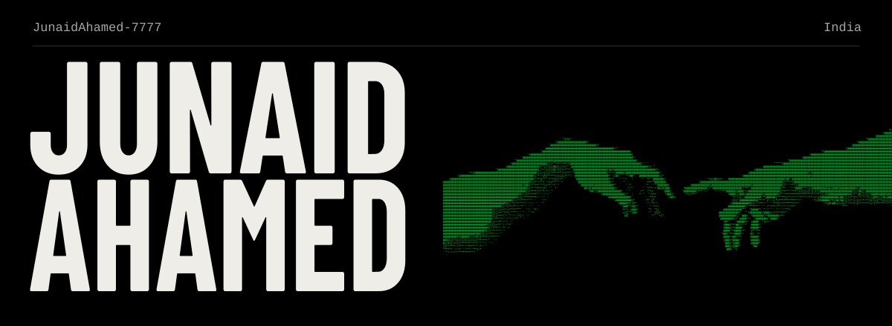
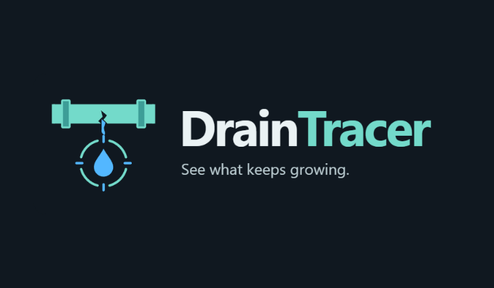
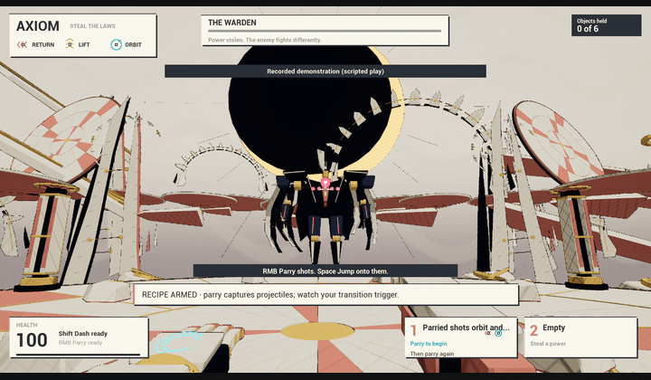

<!-- Artwork: scripts/build_assets.py. The masthead uses my original ASCII image. -->

<a href="https://junaidahamed.runs-on.dev">
  <picture>
    <source media="(max-width: 650px)" srcset="assets/hero-mobile.svg">
    
  </picture>
</a>

<a href="https://junaidahamed.runs-on.dev">
  <picture>
    <source media="(prefers-reduced-motion: reduce) and (max-width: 650px)" srcset="assets/portfolio-mobile-static.svg">
    <source media="(prefers-reduced-motion: reduce)" srcset="assets/portfolio-static.svg">
    <source media="(max-width: 650px)" srcset="assets/portfolio-mobile.svg">
    
  </picture>
</a>

  <a href="#selected-work">Selected work</a>
  &nbsp; / &nbsp;
  <a href="#open-source">Open source</a>
  &nbsp; / &nbsp;
  <a href="#research">Research</a>

## Selected work

<table>
  <tr>
    <td width="50%" valign="top">
      
      <h3>DrainTracer</h3>
      
pip install draintracer

      
Python · psutil · Rich

      <a href="https://github.com/JunaidAhamed-7777/DrainTracer">Code</a>
    </td>
    <td width="50%" valign="top">
      
      <h3>Modif.in</h3>
      
Free browser tools for text, images, and documents.

      
React · JavaScript · Vite

      <a href="https://modif.in">Website</a>
    </td>
  </tr>
  <tr>
    <td width="50%" valign="top">
      
      <h3>Outrun Your Soul</h3>
      
A touch-first action game where your body dashes ahead while your vulnerable soul follows the path you leave behind.

      
TypeScript · Three.js · Blender

      <a href="https://github.com/JunaidAhamed-7777/outrun-your-soul">Code</a>
      &nbsp; · &nbsp;
      <a href="https://outrun-your-soul.vercel.app">Play Now!</a>
    </td>
    <td width="50%" valign="top">
      <a href="https://github.com/JunaidAhamed-7777/axiom-steal-the-laws">
        <picture>
          <source media="(prefers-reduced-motion: reduce)" srcset="assets/project-axiom-static.png">
          
        </picture>
      </a>
      <h3>Axiom: Break the laws</h3>
      
A pencil-and-ink FPS where you rewrite the laws of combat.

      
Unreal Engine · C++ · Python

      <a href="https://github.com/JunaidAhamed-7777/axiom-steal-the-laws">Code</a>
      &nbsp; · &nbsp;
      <a href="https://github.com/JunaidAhamed-7777/axiom-steal-the-laws/blob/main/Evidence/Demo/AXIOM_final_native_live_demo.mp4">Gameplay</a>
    </td>
  </tr>
</table>

Other projects

- **[Sign Saber](https://github.com/JunaidAhamed-7777/sign-saber)** — A browser rhythm-combat game with a holographic avatar, custom-audio beatmaps, and experimental webcam gesture tracking.
- **[TypeShift](https://github.com/JunaidAhamed-7777/Type.Shift)** — A typing speed checker with real-time WPM and accuracy tracking, difficulty-based challenges, and passages from books, science, and code. [Demo](https://typeshiftt.vercel.app).
- **[Ghostwalk](https://github.com/JunaidAhamed-7777/ghostwalk)** — A first-place NexAI hackathon project that turns real orders into a playable 3D warehouse, using simulated annealing to reduce walking distance by 11.1% against a frequency-based baseline on held-out orders in simulation.
- **[CargoMind](https://github.com/JunaidAhamed-7777/cargomind)** — A first-place hackathon prototype coordinating 23 Google ADK agents and 11 MCP tools for logistics planning, disruption response, and recovery from model and tool failures.
- **[AI Content Breaker](https://github.com/rohithgreninja-afk/AI-Content-Breaker)** — An experimental AI-text detector built around a custom lexer and parser, 89 lexical and syntactic features, and a 300-tree ExtraTrees classifier trained from scratch with reproducible evaluation.
- **[Groundhog CI](https://github.com/JunaidAhamed-7777/groundhog-ci)** — A searchable memory for recurring CI failures that groups JUnit reports and retrieves previously recorded fixes through local MiniLM inference, keeping the source evidence available for review.
- **[Release Sieve](https://github.com/JunaidAhamed-7777/release-sieve)** — A release-review tool that compares commit metadata with release notes using local MiniLM inference, flagging possible omissions and breaking changes in reports linked to source evidence.
- **[StockFlow](https://github.com/JunaidAhamed-7777/StockFlow)** — An inventory platform spanning customer, supplier, and admin workspaces, with PostgreSQL-backed stock and order management plus n8n automation for alerts, follow-ups, and inventory digests.
- **[Blackwall](https://github.com/JunaidAhamed-7777/Blackwall)** — An infrastructure approval platform that combines multi-factor authentication, role-based access, two-person approval quorums, escalation, and rollback controls to make sensitive changes explicit and traceable.
- **[Heimdall](https://github.com/JunaidAhamed-7777/Heimdall)** — A productivity companion with four specialized Gemini agents that extracts action items from Gmail, synchronizes Google Calendar, monitors Drive, and brings planning, habits, and weekly reports into one workspace.
- **[ResQ](https://www.linkedin.com/in/junaidahamed7777/details/projects/)** — An ambulance dispatch backend connecting patient, driver, and admin workflows through automatic driver matching, live GPS tracking, real-time notifications, and encrypted personal data.
- **[Crystal UI](https://github.com/JunaidAhamed-7777/CrystalUI_Vivaldi)** — An iOS-inspired redesign of Vivaldi's browser chrome, unifying frosted glass, translucent tabs, transparent side panels, and custom controls through CSS.
- **[Emotion Detector](https://github.com/JunaidAhamed-7777/Emotion_detector_music_rcmdr)** — A computer vision music recommender that classifies expressions from live webcam landmarks and turns the detected emotion, preferred language, and artist into personalized song searches.
- **[AirQuality Monitor](https://github.com/JunaidAhamed-7777/AirQuality-Humidity-PPM-Monitor-using-ESP32)** — An ESP32 environmental monitor combining temperature, humidity, and gas sensing with automatic baseline calibration, adjustable thresholds, and coordinated LCD, LED, and buzzer alerts.
- **[Futures Trading CLI](https://github.com/JunaidAhamed-7777/trading_bot)** — A Python CLI for Binance USDT Futures Testnet that executes market and limit orders with strict input validation, structured execution logs, and explicit handling of network and exchange errors.

# Open source

Merged pull requests.

**[pydantic](https://github.com/pydantic/pydantic-settings)**

- [#1034](https://github.com/pydantic/pydantic-settings/pull/1034) — Expand home paths when checking TOML table headers.

**[boltons](https://github.com/mahmoud/boltons)**
- [#580](https://github.com/mahmoud/boltons/pull/580) — Fix cache equality with dictionaries and unrelated objects.

**[lilconfig](https://github.com/antonk52/lilconfig)** `(Used in 16 million repositories)`

- [#66](https://github.com/antonk52/lilconfig/pull/66) — Fix: strip UTF-8 BOM before parsing JSON configs.

**[Python Validators](https://github.com/python-validators/validators)**
- [151](https://github.com/python-validators/validators/pull/512) — Reject non-ASCII case equivalents in IBANs

**[Arbor](https://github.com/Anandb71/arbor)**

A lot  

# Research

**[Ranking Pages for Content Refresh ↗︎](https://junaidahamed-7777.github.io/flyrank-machine-learning/)** Leakage audit and grouped validation for content-refresh ranking.

## Stack

**Languages** &nbsp; Python · Java · C · C++ · JavaScript · TypeScript **Web** &nbsp; React · Node.js **Data** &nbsp; PostgreSQL · MySQL · Redis

---

  
  &nbsp;&nbsp;
  

