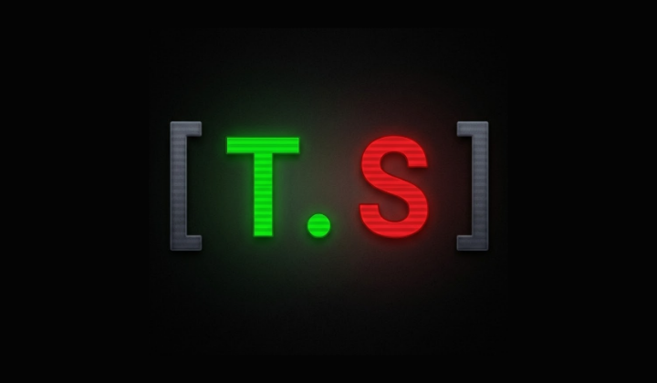

<!-- Artwork: scripts/build_assets.py. The masthead uses my original ASCII image. -->

<a href="https://junaidahamed.runs-on.dev">
  <picture>
    <source media="(max-width: 650px)" srcset="assets/hero-mobile.svg">
    
  </picture>
</a>

<a href="https://junaidahamed.runs-on.dev">
  <picture>
    <source media="(prefers-reduced-motion: reduce) and (max-width: 650px)" srcset="assets/portfolio-mobile-static.svg">
    <source media="(prefers-reduced-motion: reduce)" srcset="assets/portfolio-static.svg">
    <source media="(max-width: 650px)" srcset="assets/portfolio-mobile.svg">
    
  </picture>
</a>

  <a href="#selected-work">Selected work</a>
  &nbsp; / &nbsp;
  <a href="#open-source">Open source</a>
  &nbsp; / &nbsp;
  <a href="#research">Research</a>

## Selected work

<table>
  <tr>
    <td width="50%" valign="top">
      
      <h3>DrainTracer</h3>
      
pip install draintracer

      
Python · psutil · Rich

      <a href="https://github.com/JunaidAhamed-7777/DrainTracer">Code</a>
    </td>
    <td width="50%" valign="top">
      
      <h3>Modif.in</h3>
      
Free browser tools for text, images, and documents.

      
React · JavaScript · Vite

      &nbsp; · &nbsp;
      <a href="https://modif.in">Website</a>
    </td>
  </tr>
  <tr>
    <td width="50%" valign="top">
      <a href="https://github.com/JunaidAhamed-7777/axiom-steal-the-laws">
        <picture>
          <source media="(prefers-reduced-motion: reduce)" srcset="assets/project-axiom-static.png">
          
        </picture>
      </a>
      <h3>Axiom: Break the laws</h3>
      
A pencil-and-ink FPS where you rewrite the laws of combat.

      
Unreal Engine · C++ · Python

      <a href="https://github.com/JunaidAhamed-7777/axiom-steal-the-laws">Code</a>
      <a href="https://github.com/JunaidAhamed-7777/axiom-steal-the-laws/blob/main/Evidence/Demo/AXIOM_final_native_live_demo.mp4">Gameplay</a>
    </td>
    <td width="50%" valign="top">
      
      <h3>TypeShift</h3>
      
A typing speed checker with passages from books, science, and code.

      
React · JavaScript

      <a href="https://github.com/JunaidAhamed-7777/Type.Shift">Code</a>
      &nbsp; · &nbsp;
      <a href="https://typeshiftt.vercel.app">Demo</a>
    </td>
  </tr>
</table>

Other projects

- **[Blackwall](https://github.com/JunaidAhamed-7777/Blackwall)** — Cryptographic approval workflows for infrastructure changes.
- **[Crystal UI](https://github.com/JunaidAhamed-7777/CrystalUI_Vivaldi)** — A frosted-glass CSS theme for Vivaldi.
- **[AirQuality Monitor](https://github.com/JunaidAhamed-7777/AirQuality-Humidity-PPM-Monitor-using-ESP32)** — ESP32 environmental monitoring with real-time alerts.
- **[Futures Trading CLI](https://github.com/JunaidAhamed-7777/trading_bot)** — Order validation, execution, and logging for the Binance USDT Futures Testnet.

# Open source

Merged pull requests.

**[pydantic](https://github.com/pydantic/pydantic-settings)**

- [#1034](https://github.com/pydantic/pydantic-settings/pull/1034) — Expand home paths when checking TOML table headers.

**[lilconfig](https://github.com/antonk52/lilconfig)** `(Used in 16 million repositories)`

- [#66](https://github.com/antonk52/lilconfig/pull/66) — Fix: strip UTF-8 BOM before parsing JSON configs.

**[Arbor](https://github.com/Anandb71/arbor)**

- [#189](https://github.com/Anandb71/arbor/pull/189) — Exclude vendor assets and compute hotspot centrality.
- [#190](https://github.com/Anandb71/arbor/pull/190) — Fix the PageRank closed-cycle rank sink and balance score distribution.
- [#191](https://github.com/Anandb71/arbor/pull/191) — Emit class inheritance edges and reach inherited methods. 

# Research

**[Ranking Pages for Content Refresh ↗︎](https://junaidahamed-7777.github.io/flyrank-machine-learning/)** Leakage audit and grouped validation for content-refresh ranking.

## Stack

**Languages** &nbsp; Python · Java · C · C++ · JavaScript · TypeScript **Web** &nbsp; React · Node.js **Data** &nbsp; PostgreSQL · MySQL · Redis

---

  
  &nbsp;&nbsp;
  

