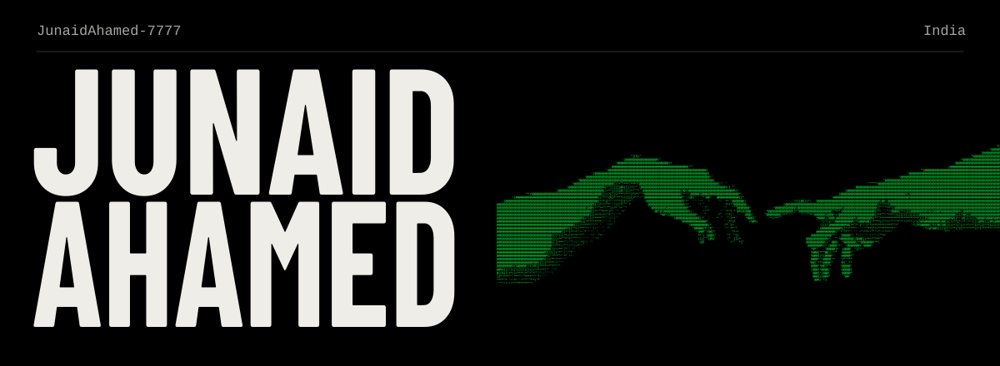
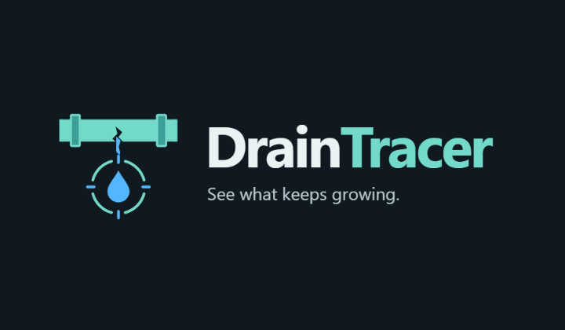
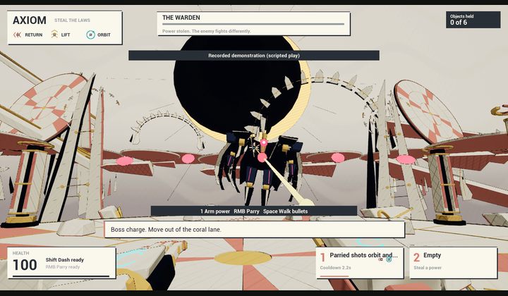

<!-- Artwork: scripts/build_assets.py. The masthead uses my original ASCII image. -->

<a href="https://junaidahamed.runs-on.dev">
  <picture>
    <source media="(max-width: 650px)" srcset="assets/hero-mobile.svg">
    
  </picture>
</a>

<a href="https://junaidahamed.runs-on.dev">
  <picture>
    <source media="(prefers-reduced-motion: reduce) and (max-width: 650px)" srcset="assets/portfolio-mobile-static.svg">
    <source media="(prefers-reduced-motion: reduce)" srcset="assets/portfolio-static.svg">
    <source media="(max-width: 650px)" srcset="assets/portfolio-mobile.svg">
    
  </picture>
</a>

## Selected work

<table>
  <tr>
    <td width="50%" valign="top">
      
      <h3>DrainTracer</h3>
      
pip install draintracer

      
Python · psutil · Rich

      <a href="https://github.com/JunaidAhamed-7777/DrainTracer">Code</a>
    </td>
    <td width="50%" valign="top">
      
      <h3>Modif.in</h3>
      
Free browser tools for text, images, and documents.

      
React · JavaScript · Vite

      <a href="https://modif.in">Website</a>
    </td>
  </tr>
  <tr>
    <td width="50%" valign="top">
      
      <h3>Outrun Your Soul</h3>
      
A touch-first action game where your body dashes ahead while your vulnerable soul follows the path you leave behind.

      
TypeScript · Three.js · Blender

      <a href="https://github.com/JunaidAhamed-7777/outrun-your-soul">Code</a>
      &nbsp; · &nbsp;
      <a href="https://outrun-your-soul.vercel.app">Play Now!</a>
    </td>
    <td width="50%" valign="top">
      
      <h3>Chowk</h3>
      
Traffic signals that learn from the way Indian streets move. Compare controllers live in a 3D city, stall a bus or send an ambulance, and replay the benchmark in your browser.

      
November 2026 · INNOVEX · TypeScript · Three.js · Evolution strategies

      <a href="https://github.com/JunaidAhamed-7777/chowk">Code</a>
      &nbsp; · &nbsp;
      <a href="https://chowk-seven.vercel.app/">Live Demo</a>
      &nbsp; · &nbsp;
      <a href="https://chowk-seven.vercel.app/results">Benchmark</a>
    </td>
  </tr>
</table>

𝐎𝐓𝐇𝐄𝐑 𝐏𝐑𝐎𝐉𝐄𝐂𝐓𝐒🥴🥴🥴

- **[Patchwork](https://github.com/JunaidAhamed-7777/patchwork)** · November 2026 — A correction desk for Buffer drafts. Change a date or venue once, review the exact words that will change in each draft, and send back only the edits you approve. Patchwork checks the saved text and issues a receipt per draft. Built for Buffer Commit 2026. [Try the sample workspace](https://patchwork-workbench.vercel.app/) · [Showcase](https://patchwork-showcase.vercel.app/). 
- **[Chowk](https://github.com/JunaidAhamed-7777/chowk)** · November 2026 — A learned signal controller for lane-free Indian traffic. Across 20 held-out simulation seeds, it reduced delay per person by 4.5% versus Webster fixed timing. The browser replays published runs and checks their final state hashes. [Live 3D demo](https://chowk-seven.vercel.app/) · [Reproduce the benchmark](https://chowk-seven.vercel.app/results). 
- **[Axiom: Break the laws](https://github.com/JunaidAhamed-7777/axiom-steal-the-laws)** · October 2026 — A pencil-and-ink Unreal FPS where you steal enemy abilities and use their bullets as building material. Describe a curve, staircase, or bridge and the game turns the idea into solid footing you can jump onto mid-fight. [Gameplay](https://github.com/JunaidAhamed-7777/axiom-steal-the-laws/blob/main/Evidence/Demo/AXIOM_final_native_live_demo.mp4). 

- **[Sign Saber](https://github.com/JunaidAhamed-7777/sign-saber)** — Browser rhythm combat with a 43-bone holographic avatar, custom-audio beatmap generation, slicing and beam mechanics, and on-device music analysis with optional webcam tracking.
- **[TypeShift](https://github.com/JunaidAhamed-7777/Type.Shift)** — A typing-performance platform combining live WPM and accuracy scoring, four difficulty levels, timed challenges, and nonrepeating passages drawn from literature, scientific writing, and programming. [Demo](https://typeshiftt.vercel.app).
- **[Ghostwalk](https://github.com/JunaidAhamed-7777/ghostwalk)** — A first-place NexAI hackathon winner that replays 2,362 real orders in a 3D warehouse and uses simulated annealing to cut simulated walking distance by 11.1% against a frequency-based baseline on held-out orders.
- **[CargoMind](https://github.com/JunaidAhamed-7777/cargomind)** — A first-place hackathon logistics control tower with 23 Google ADK agents, 11 MCP tools, proactive disruption response, independent dispatch-plan review, and automatic recovery across model providers.
- **[SubTrack](https://github.com/lakshmir23/SubTrack)** — A subscription billing platform unifying quotations, recurring invoices, collections, and finance, benchmarked on **10,000 subscriptions, 30,000 invoices, and 60,000 invoice lines** with deterministic accounting and retry-safe billing.
- **[AI Content Breaker](https://github.com/rohithgreninja-afk/AI-Content-Breaker)** — A compiler-inspired AI-text analysis workbench with an inspectable lexer, CFG parser, 89 stylometric features, and a 300-tree ExtraTrees classifier trained from scratch.
- **[Groundhog CI](https://github.com/JunaidAhamed-7777/groundhog-ci)** — A searchable memory for recurring CI failures that combines JUnit ingestion, local MiniLM retrieval, and versioned fix notes with source evidence shared between the browser and CLI.
- **[Dead Letter Office](https://github.com/JunaidAhamed-7777/dead-letter-office)** — An offline semantic archive combining MiniLM and TF-IDF search with exact quotations, paragraph-level citations, and inspectable conflicting accounts from a fictional 1924 town.
- **[Release Sieve](https://github.com/JunaidAhamed-7777/release-sieve)** — A browser and CLI release auditor that compares commit metadata with release notes using local MiniLM inference, surfacing potential omissions and breaking changes in traceable HTML, JSON, and Markdown reports.
- **[StockFlow](https://github.com/JunaidAhamed-7777/StockFlow)** — An inventory platform with customer, supplier, and admin portals, PostgreSQL-backed order and dispatch workflows, five n8n automations, and three read-only AI assistants.
- **[Charades](https://github.com/JunaidAhamed-7777/Charades)** — A native Android party game built with Kotlin and Jetpack Compose, bundling seven illustrated categories for offline Charades and 20 Questions without accounts, ads, or network permissions.
- **[Blackwall](https://github.com/JunaidAhamed-7777/Blackwall)** — Infrastructure change control with multi-factor authentication, role-based dashboards, two-of-three approval quorums, escalation, rollback controls, and a decision history spanning proposals, approvals, rejections, and comments.
- **[Heimdall](https://github.com/JunaidAhamed-7777/Heimdall)** — A Gemini-powered productivity workspace that converts Gmail confirmations into tasks, synchronizes Google Calendar, monitors Drive activity, and combines conversational scheduling, voice input, habit tracking, and weekly analytics.
- **[ResQ](https://www.linkedin.com/in/junaidahamed7777/details/projects/)** — An ambulance dispatch backend connecting patient, driver, and admin workflows through automatic driver matching, live GPS tracking, real-time notifications, and encrypted personal data.
- **[Crystal UI](https://github.com/JunaidAhamed-7777/CrystalUI_Vivaldi)** — An iOS-inspired transformation of Vivaldi's browser chrome, combining frosted glass, translucent active tabs, transparent side panels, and redesigned Speed Dial navigation through custom CSS.
- **[Emotion Detector](https://github.com/JunaidAhamed-7777/Emotion_detector_music_rcmdr)** — A real-time computer vision music recommender that feeds MediaPipe facial and hand landmarks into a trained Keras classifier, then matches YouTube song searches to emotion, language, and artist.
- **[AirQuality Monitor](https://github.com/JunaidAhamed-7777/AirQuality-Humidity-PPM-Monitor-using-ESP32)** — An ESP32 environmental monitoring system combining DHT22 temperature and humidity sensing, automatically baselined MQ2 gas detection, live LCD readings, serial diagnostics, and coordinated visual and audible alerts.
- **[Futures Trading CLI](https://github.com/JunaidAhamed-7777/trading_bot)** — A Python order-execution CLI for Binance USDT Futures Testnet, supporting market and limit orders on both sides with parameter validation, detailed API activity logs, and exchange/network failure handling.

<!--  -->

---

  
  
  &nbsp;&nbsp;
  

